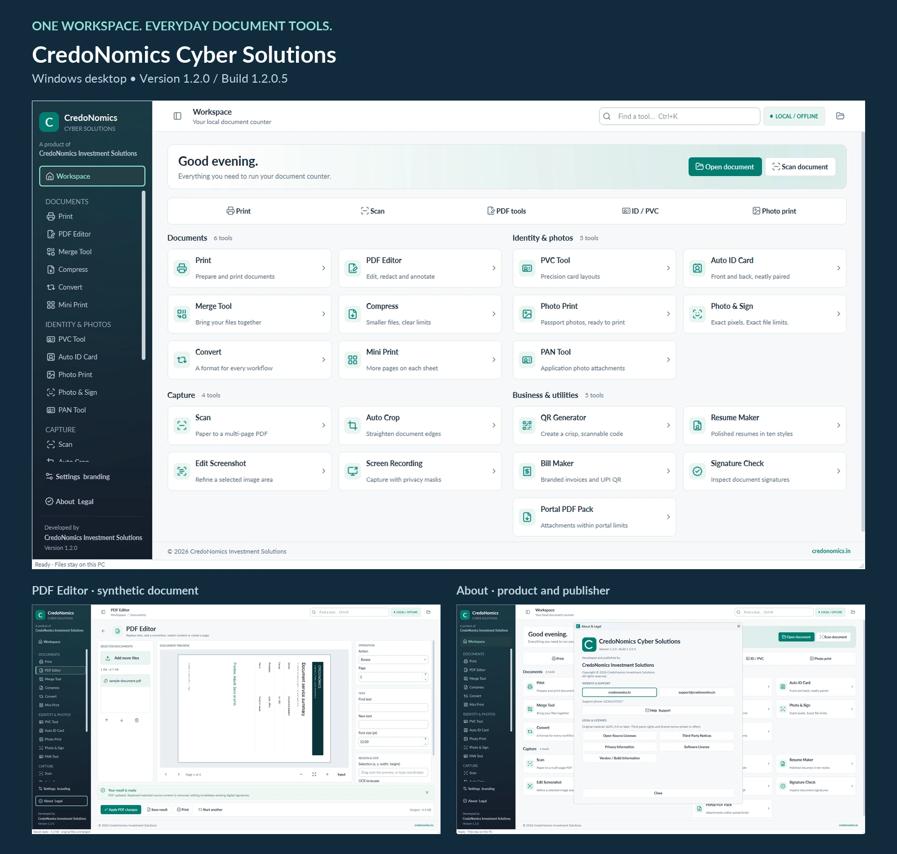
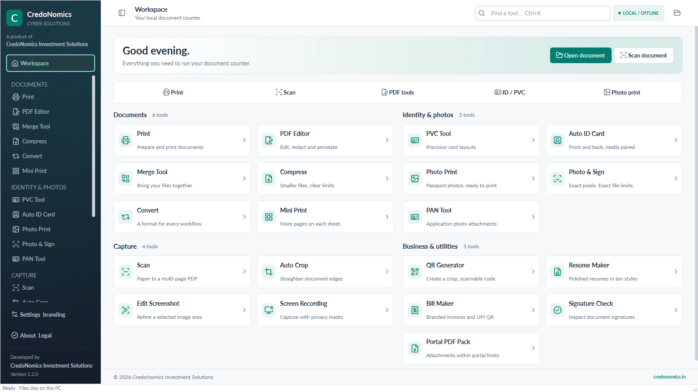
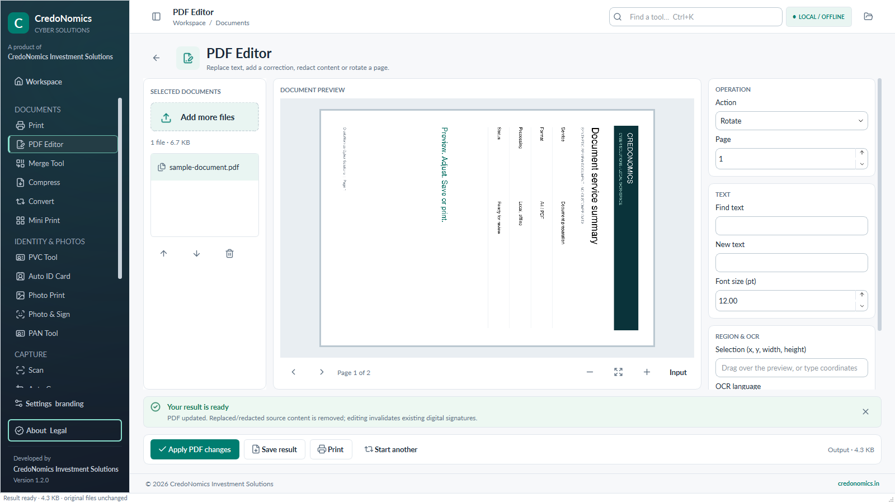
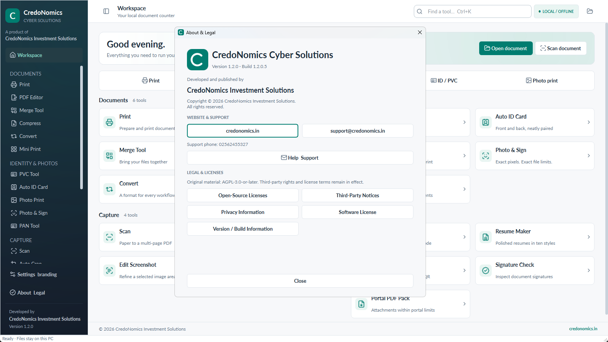
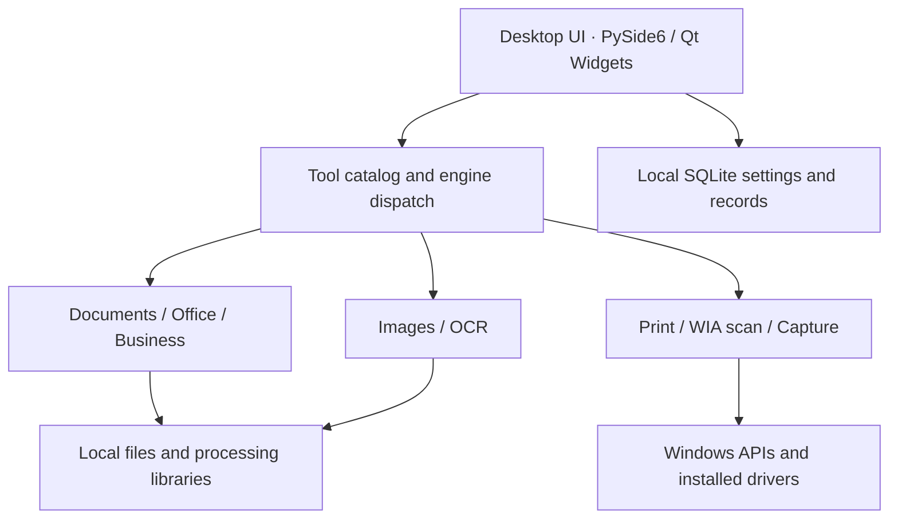

<h1 align="center">
  <picture>
    <source media="(prefers-color-scheme: dark)" srcset="docs/public/credonomics-cyber-solutions-logo-dark.svg">
    <source media="(prefers-color-scheme: light)" srcset="docs/public/credonomics-cyber-solutions-logo-light.svg">
    
  </picture>
</h1>

<p align="center"><strong>Open-source Windows document productivity and utility suite.</strong><br>
Developed and published by CredoNomics Investment Solutions.</p>

<p align="center">
  <a href="https://github.com/aqdas1820/credonomics-cyber-solutions/releases/tag/v1.2.0"></a>
  <a href="#built-for-windows"></a>
  <a href="#build-from-source"></a>
  <a href="docs/ARCHITECTURE.md"></a>
  <a href="https://github.com/aqdas1820/credonomics-cyber-solutions/actions/workflows/ci.yml"></a>
  <a href="LICENSE"></a>
</p>

<p align="center">
  <strong><a href="https://github.com/aqdas1820/credonomics-cyber-solutions/releases/download/v1.2.0/CredoNomics-Cyber-Solutions-Windows.zip">Download for Windows</a></strong> ·
  <a href="https://github.com/aqdas1820/credonomics-cyber-solutions/releases/latest">Latest Release</a> ·
  <a href="#features">Features</a> · <a href="#screenshots">Screenshots</a> ·
  <a href="#architecture">Architecture</a> · <a href="#build-from-source">Build from Source</a> ·
  <a href="CONTRIBUTING.md">Contributing</a>
</p>

CredoNomics Cyber Solutions brings common document, print, scan, OCR, image and
small-business utilities into one Windows desktop workspace. Prepare a document,
preview the result, then save or print. Most processing uses local libraries;
device drivers and optional converters have their own requirements.
**[Documentation →](docs/README.md)**

## Download for Windows

**CredoNomics Cyber Solutions v1.2.0 — Windows x64** · Build **1.2.0.5**

### [Download CredoNomics-Cyber-Solutions-Windows.zip](https://github.com/aqdas1820/credonomics-cyber-solutions/releases/download/v1.2.0/CredoNomics-Cyber-Solutions-Windows.zip)

**Download → Extract → Run `CredoNomics Cyber Solutions.exe`**

Python is **not required** for the portable build. Extract the ZIP to a writable
folder, open the `CredoNomics Cyber Solutions` folder, and keep `_internal` beside
the executable. Keep the complete application folder together; run it after extraction.

The executable is **unsigned**. Windows may display a reputation or security
warning. Keep security protections enabled and verify the download before use.
GitHub's automatic source archives are for developers; choose the Windows ZIP
above for the ready-made application.

<details>
<summary>Verify your download</summary>

Download [SHA256SUMS.txt](https://github.com/aqdas1820/credonomics-cyber-solutions/releases/download/v1.2.0/SHA256SUMS.txt).
The accepted Windows ZIP SHA-256 is:

```text
b64fbb35e25dc3804b0f096c5727c596439e16e56cc9a2227b56b56787c3e0aa
```

```powershell
Get-FileHash -Algorithm SHA256 -LiteralPath .\CredoNomics-Cyber-Solutions-Windows.zip
```

Compare the full value. [Read the v1.2.0 release notes](https://github.com/aqdas1820/credonomics-cyber-solutions/releases/tag/v1.2.0).

</details>

[](docs/public/product-preview.webp)

*Current Windows product views; document content is synthetic. Select the preview to enlarge.*

## Features

| Workflow | Capabilities |
| --- | --- |
| **Documents & PDF** | Text replacement, annotations, redaction, rotation, merge, compression and conversion. |
| **Print & Scan** | Print preparation, page selection, duplex options, multiple pages per sheet, Windows WIA scanning, scan imports, edge detection and multi-page PDFs. |
| **OCR & Images** | Local English/Hindi OCR, image region edits, ID/PVC layouts, photo sheets, photo/signature sizing and form attachments. |
| **Business utilities** | Invoices, ten resume layouts, QR generation and UPI request QR codes. |
| **Capture & Privacy** | Screen recording with rectangular privacy masks. |
| **Signature inspection** | Inspection of existing PDF signatures using local trust inputs. |

Review outputs before use. Compression can rasterise pages and remove searchable
text, links and signatures; edits can invalidate signatures. Offline signature
inspection cannot establish current revocation status. Background-removal weights
are not supplied or enabled; original-background photo workflows remain available.

## Built for Windows

Windows **10/11 x64** is the supported desktop platform. The PySide6 interface
connects document workflows to Windows print/device integration and WIA scanners.
The portable release includes its Python runtime. Physical printing and scanning
require compatible hardware and installed drivers; automated tests do not certify
devices. Other desktop platforms are not verified.

Basic DOCX/XLSX conversions use local libraries. Some legacy Office conversions
need separately installed LibreOffice.

## Local-first document processing

Document processing normally uses local libraries; documents are not automatically
uploaded. Settings, counters and saved business records stay in local storage.
Processing creates temporary files and bounded diagnostics. Website/email controls
can open external applications; drivers, network printers, remote folders and
optional converters have their own behavior.

Read [Data Handling](docs/legal/DATA-HANDLING.md) for storage, logs and cleanup.
`CREDONOMICS_DATA_DIR` selects a different local data directory. Keep records and
backups private.

## Screenshots

Three selected views from Windows build **1.2.0.5**. Select any image for full size.

<table>
  <tr>
    <td><a href="docs/screenshots/workspace.png"></a><br><strong>Workspace</strong> — tool navigation.</td>
    <td><a href="docs/screenshots/pdf-editor.png"></a><br><strong>PDF Editor</strong> — preview and save.</td>
  </tr>
</table>

<details>
<summary>About & Legal — version, publisher and local notices</summary>

[](docs/screenshots/about.png)

These screenshots show the published Windows build. The source distribution's
first-party license is **AGPL-3.0-only**, as specified in [LICENSE](LICENSE).

</details>

## Architecture



Background workers handle long-running operations; previews precede explicit
save/print actions. Shared helpers manage temporary workspaces, limits and
diagnostics. Windows packaging uses PyInstaller and preserves dependency notices.
See [Architecture](docs/ARCHITECTURE.md) for module responsibilities and boundaries.

## Build from source

Use Windows x64 and Python **3.14 x64**. Internet access is needed to install
dependencies. OCR data and licensed UI assets are included. No company account,
API key or private settings file is required.

```powershell
git clone https://github.com/aqdas1820/credonomics-cyber-solutions.git
cd credonomics-cyber-solutions

py -3.14 -m venv .venv
.\.venv\Scripts\python.exe -m pip install -r requirements.lock
.\setup-model.ps1 -OcrOnly
.\.venv\Scripts\python.exe main.py
```

The OCR setup verifies included data against fixed SHA-256 hashes and downloads
missing files from pinned upstream revisions. It does not provision background
removal. `launch.cmd` starts the local source environment.

### Package a local Windows build

Install development dependencies first, as described in
[Contributing](CONTRIBUTING.md), then run:

```powershell
.\build.ps1
```

This runs tests and packages the source into `dist/CredoNomics Cyber Solutions/`.
Keep the complete output folder together. Local builds are unsigned; bit-for-bit
reproduction of the published ZIP is not promised. CI does not automatically
publish or sign executables. [Building on Windows](docs/BUILDING.md) covers the
spec, notices and optional Store packaging. A placeholder identity is not a
reserved Microsoft Store identity or a certification claim.

## Testing and engineering evidence

```powershell
.\.venv\Scripts\python.exe -m pip install -r requirements-dev.txt
$env:QT_QPA_PLATFORM = "offscreen"
.\.venv\Scripts\python.exe -m pytest -q
```

- The published v1.2.0 source snapshot passed **206 automated tests**; see the
  [publication manifest](PUBLICATION_MANIFEST.md) for the recorded environment.
- [Windows CI](https://github.com/aqdas1820/credonomics-cyber-solutions/actions/workflows/ci.yml)
  blocks on regression tests, dependency consistency and OCR integrity checks.
- Tests use synthetic documents and cover processing, exports, UI behavior,
  retention, failure handling, branding and package policy.
- [requirements.lock](requirements.lock) records the tested Windows dependency
  closure; [the dependency inventory](docs/DEPENDENCIES.md) documents its scope.
- Release checksums and a [public security policy](SECURITY.md) support review.

Existing lint/type findings are reported separately as informational checks.

## Repository structure

| Path | Purpose |
| --- | --- |
| `main.py`, `store_main.py` | Desktop entry points |
| `cyber/` | UI, processing engines, storage and device integration |
| `assets/`, `brand/` | Licensed UI assets and product identity |
| `tessdata/` | Hash-verified English/Hindi OCR data |
| `tests/` | Synthetic automated regression suite |
| `scripts/`, `packaging/` | Device checks and Windows packaging tools |
| `CredoNomics.spec` | PyInstaller configuration |
| `third-party-licenses/` | Preserved upstream license and notice texts |
| `docs/` | Architecture, build, privacy and public presentation assets |

## Documentation

**[Documentation →](docs/README.md)** · [Architecture](docs/ARCHITECTURE.md) ·
[Building](docs/BUILDING.md) · [Data Handling](docs/legal/DATA-HANDLING.md) ·
[Dependencies](docs/DEPENDENCIES.md)

## Contributing

Start with [Contributing](CONTRIBUTING.md) and the
[Code of Conduct](CODE_OF_CONDUCT.md). Use focused pull requests with synthetic
inputs and reproducible verification. The issue forms help capture bug reports
and feature requests; include only non-sensitive material.

## Security

Report vulnerabilities privately to [support@credonomics.in](mailto:support@credonomics.in).
Read the [security policy](SECURITY.md). Do not attach private documents,
passwords or credentials to public issues.

## License and third-party notices

First-party source is **GNU Affero General Public License v3.0 only
(AGPL-3.0-only)**. See [LICENSE](LICENSE) and [COPYRIGHT.txt](COPYRIGHT.txt).
Third-party components retain their own licenses; their required notices remain
in [THIRD_PARTY_NOTICES.md](THIRD_PARTY_NOTICES.md) and `third-party-licenses/`.
The software license does not claim ownership of supplier libraries, fonts,
icons or OCR data. [TRADEMARKS.md](TRADEMARKS.md) explains product identity usage.

## Support and publisher

**CredoNomics Investment Solutions**

[credonomics.in](https://credonomics.in) ·
[support@credonomics.in](mailto:support@credonomics.in) · Phone: 02562455327

Copyright © 2026 CredoNomics Investment Solutions.
