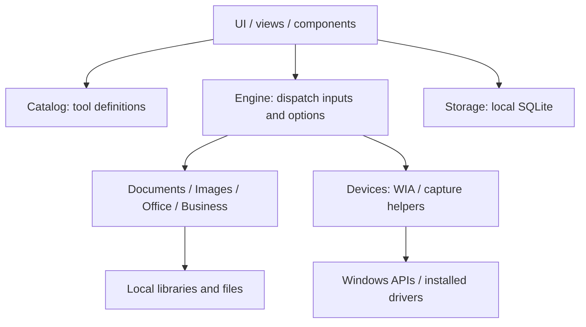

# Architecture

[Documentation](README.md) · [Product overview](../README.md)

The desktop process uses Python and PySide6/Qt Widgets. `main.py` launches the
application; `store_main.py` supplies the production entry point used by the
default package profile. Product identity is read from `brand/brand.json`.

## Processing flow

The diagram shows runtime responsibilities, rather than a separate service
deployment. Processing and UI share a desktop process; background workers keep
long operations away from the main interaction loop.

## Module responsibilities

Module names below are relative to `cyber/`.

| Modules | Responsibility |
| --- | --- |
| `ui`, `views`, `components`, `tool_layouts`, `theme`, `glass` | Navigation, forms, preview, dialogs and appearance |
| `catalog` | Tool definitions, fields and descriptive guidance |
| `engine` | Dispatch from tool inputs/options to processing results |
| `documents`, `images`, `office`, `business` | PDF/image/Office processing, invoice and resume generation |
| `devices` | WIA discovery/capture, recording and device helpers |
| `storage` | SQLite settings, counters and saved business records |
| `tempfiles`, `limits`, `diagnostics` | Temporary-workspace cleanup, resource limits and bounded diagnostics |
| `legal`, `distribution`, `windows_package` | Local notices, profile policy and Windows package identity/storage |

Long-running UI work runs through background workers. Results are previewed
before explicit save/print actions. Inputs should be treated as untrusted;
operations aim to preserve originals. Tests generate synthetic documents and
exercise fault handling, Unicode paths, record persistence and UI layout.

## Data and platform boundaries

`storage` owns local settings and saved records. `tempfiles`, `limits` and
`diagnostics` support processing across tools. See
[Data Handling](legal/DATA-HANDLING.md) for persistence, diagnostics and cleanup.
Windows drivers and optional installed converters remain external boundaries;
tests use synthetic inputs and do not establish physical-device compatibility.

## Distribution

PyInstaller bundles the selected entry point, runtime and assets into a Windows
application folder. Packaging is separate from document processing. See
[Building on Windows](BUILDING.md) for output layout and supplier notice duties.

The supplied `COMMERCIAL-PROFILE.json` selects the Store-compatible restricted
profile: unapproved background weights are not enabled. It does not certify
or publish a Microsoft Store package. Optional development utilities are
source code and do not imply an external service dependency.
